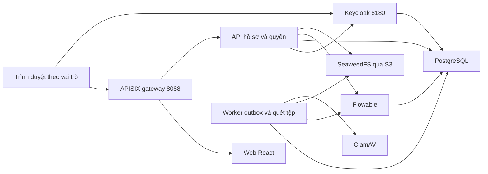

# Kiến trúc SchoolOps

Trình duyệt truy cập web và API qua gateway; đăng nhập qua Keycloak. API và worker dùng cùng database ứng dụng và cùng các adapter workflow/tệp/scanner. Sơ đồ mô tả cấu hình local trong `compose.yaml`, không phải kiến trúc HA hoặc production.

SVG được render bằng Mermaid 12.0.0. Mã dưới đây giữ cấu trúc để sửa cùng source; SVG và đoạn mô tả giúp đọc được trên trình xem không hỗ trợ Mermaid.

PostgreSQL chứa ba database tách cho ứng dụng, Identity và Flowable. Web không đọc database hoặc kho tệp trực tiếp. API kiểm tra quyền khi đọc hồ sơ, thao tác task và tải tệp; role `admin` quản trị gói không mặc định có quyền đọc nội dung G03. SeaweedFS, ClamAV và database không mở cổng ra host trong cấu hình RC.

Mỗi case giữ tham chiếu revision gói và định nghĩa workflow đã dùng. Gói v2 thay quy tắc tạo mới; case cũ tiếp tục dùng revision đã pin. API lưu lệnh bền vững để worker đối soát khi engine hoặc worker gián đoạn; UI có thể hiển thị “Chờ đối soát” trong thời gian chưa xác nhận kết quả.

Tệp được lưu cùng checksum và trạng thái quét. Chỉ tệp sạch, đúng quyền và đúng lần xử lý mới được dùng khi chính sách task yêu cầu. Xem [gói phiên bản](PHASE-4.md), [bằng chứng và đối soát](PHASE-3.md), [G03](PHASE-6.md) và [OpenAPI](openapi.yaml) cho các ràng buộc chi tiết.

[Client HTTP một file](../examples/headless-client/README.md) minh họa caller ngoài UI/node_modules dùng Identity và foundation qua gateway. Bộ kiểm chép client ra thư mục riêng để kiểm cùng hợp đồng, role và workflow thật. Foundation còn là adapter probe trong backend SchoolOps; việc này không chứng minh backend đã tách hoàn toàn nghiệp vụ hoặc hỗ trợ ứng dụng/BPMN tùy ý. README ví dụ liệt kê phần dùng lại và phần phải thay khi làm nghiệp vụ khác.

Nếu trình xem Markdown không render Mermaid, các thành phần và quan hệ được mô tả trong đoạn văn trên; mã sơ đồ có thể chỉnh cùng source trong Git.
