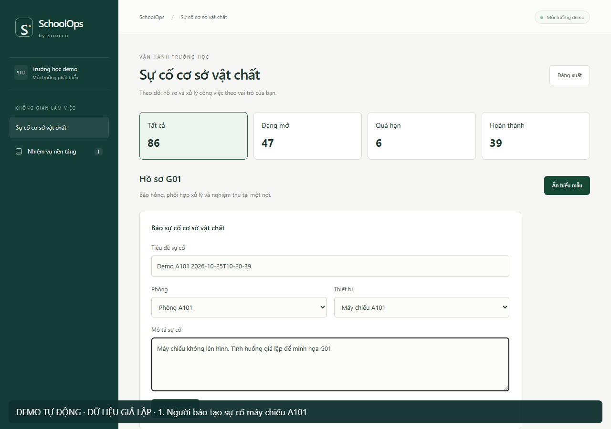
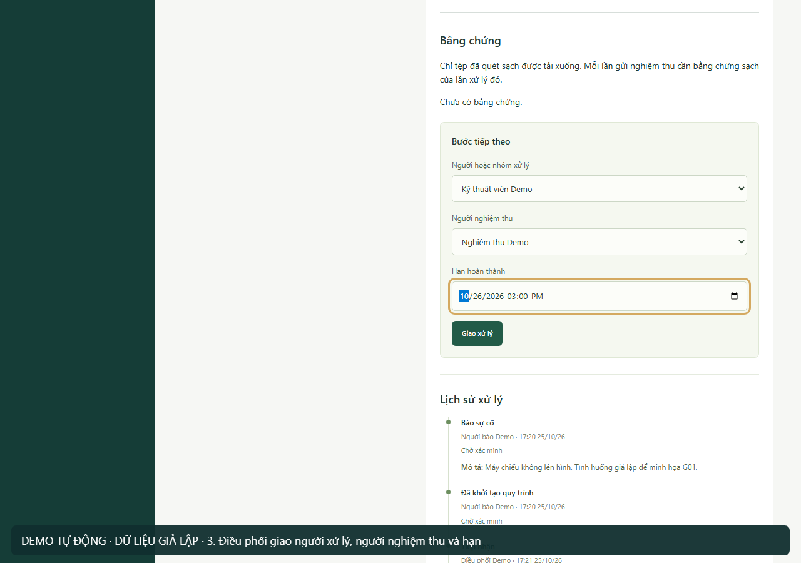
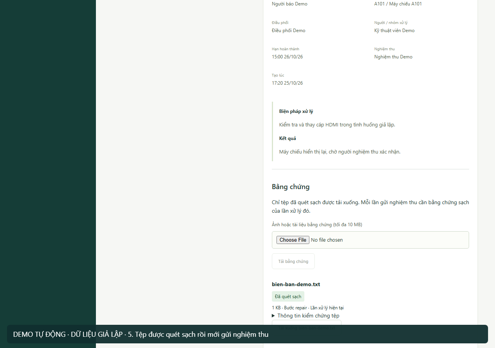
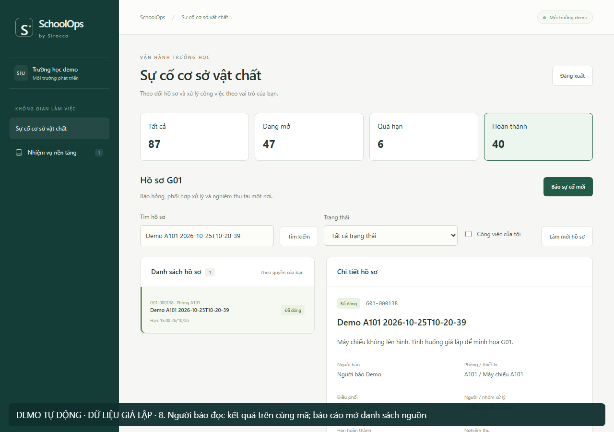
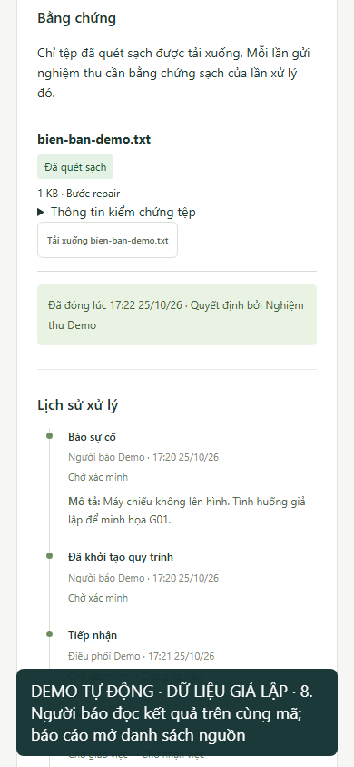

# Ảnh và video demo

Các ảnh và video dưới đây được ghi từ ứng dụng v0.1.0-rc.1 đang chạy, source `84f2ecfe31ff12b0d4cb3cd09899e37f14975e55`, với dữ liệu giả lập. Luồng do Playwright thao tác tự động; chưa phải buổi thử với giáo viên hoặc xác nhận của người dùng mục tiêu. Tệp minh họa được bổ sung sau tag, không nằm trong archive RC ban đầu.

[Xem video G01](media/schoolops-g01-rc1.mp4). Video không có lời đọc; chú thích ở chân hình nêu vai trò và bước. Đoạn quay UI được nối với ảnh kết thúc trong 18 giây để đọc trạng thái RC; ảnh mobile được cung cấp riêng. [Kịch bản xuyên suốt](DEMO-SCRIPT.md) còn bao gồm nhánh trả lại, v1/v2, G02, G03 và khôi phục; clip G01 không thay việc chạy các phần đó.

## Người báo



## Điều phối



## Kỹ thuật và bằng chứng



## Kết quả và mobile





## Ghi lại trên demo riêng

Sau khi cài và chuẩn bị tài khoản, với runtime RC đúng SHA ở trên, chạy:

```powershell
node scripts/capture-demo.mjs --synthetic-demo
```

Script tạo và đóng một case G01 qua bốn tài khoản demo trên cùng stack, ghi WebM, ảnh và manifest vào `test-results/public-demo/`. Nó đọc mật khẩu từ `.env` local, không in secret hoặc đưa token vào manifest. Chỉ chạy trên môi trường giả lập tách biệt, không chạy giữa lịch nghiệm thu của đội. Chờ tối thiểu khoảng 150 giây; thời gian thực tế còn phụ thuộc máy và scanner.

Xem lại toàn bộ video, ảnh và manifest trước khi chọn bản công khai. Không công bố trace hoặc file backup. MP4 trong repo giữ 106 giây đầu của WebM và nối ảnh kết thúc; đoạn đổi viewport cuối bản quay được thay bằng ảnh mobile riêng để tránh vùng xám của bộ ghi. Manifest ở [media/provenance.json](media/provenance.json) ghi revision, nguồn, cách dựng, thời lượng và checksum của các tệp minh họa.
